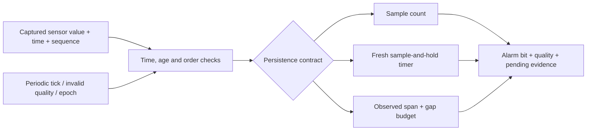

# Flight FDIR Qualification Lab

**A small C99 fault-qualification engine with explicit data freshness and three
different persistence contracts.**

What should a flight-software monitor do when a sensor stream is irregular,
duplicated, delayed or temporarily absent? This lab compares three established
approaches on the same admitted input evidence:

| Policy | An alarm/clear transition requires |
|---|---|
| `count` | N consecutive admitted qualifying samples |
| `hold` | Qualifying held data remains fresh while a timer expires |
| `observed` | Qualifying endpoint samples span the dwell interval, with bounded gaps |

These are different contracts, not a contest with one universally correct winner.
The monitor qualifies indications only; it does not isolate equipment, issue
actuator commands or implement a complete spacecraft fault-management system.

## Actual results

- **394,866 C/reference trace comparisons**, covering **2,003,430 per-event outputs**.
- Finite enumeration uses 32,768 five-token words, two synthetic configurations,
  two clock origins and three policies. These repeated comparisons are not
  independent physical failure modes or complete state-space verification.
- A list-based Python specification and actual compiled C produce matching stream
  digests. Moving the clock origin through uint32 wrap leaves output unchanged.
- **162 ARM traces / 1,638 event comparisons** pass on the same C core compiled
  for Cortex-M4 and executed in Unicorn, including input gaps and wrap cases.
- The compiled monitor context is **104 bytes** on the tested targets. The ARM
  core object has 844 text bytes in this build; the full fixture includes large
  generated test vectors. Neither number is a peak-RAM or target-timing bound.

[Raw named outputs, coverage counts and report](results/native/REPORT.md) ·
[Executed validation](VALIDATION.md) · [Skeptical assessment](docs/REVIEW.md)

## Tickless integration

`fq_next_tick_delay()` lets the worker arm a one-shot timer for the next
freshness expiry, held-value alarm or clear decision, or clock checkpoint.
In 1,536 synthetic traces, Windows and Cortex-M4 emulation both reproduced
the periodic baseline's alarm and quality transitions at the same logical
ticks. Idle tick calls fell from **109,248 to 5,582** (94.9% fewer). The
baseline polls at every idle tick and receives the same external inputs.
These counts measure monitor calls in the test workload. See the
[integration contract and measurement scope](docs/TICKLESS.md) and
[recorded results](results/tickless/tickless.json).

```sh
python tools/run_tickless.py
```

## First-sample watchdog

The optional C99 watchdog gives startup and producer restart an explicit
first-sample deadline. A channel can report a missed window while the underlying
monitor still has no usable data. Restart notifications during that wait cannot
postpone its deadline. A valid late sample restores the acquisition state and
leaves the missed-window counter available for telemetry.

Windows and Cortex-M4 emulation matched across **1,248 synthetic cases** plus
direct boundary checks. The watchdog and its monitor occupy **120 bytes** per
channel in both tested builds. [Integration and boundary rules](docs/ACQUISITION.md) ·
[Recorded results](results/acquisition/acquisition.json)

```sh
python tools/run_acquisition.py
```

### Restart policy comparison

An IMU restart model based on the open F Prime component compares the C
watchdog with a per-attempt timeout and a per-attempt timeout with a total cap.
The uncapped policy can postpone a notice throughout repeated resets. At an
equal total deadline, the capped baseline and the C watchdog agreed in all
**864 synthetic cases**. [Experiment, trade-off and limits](docs/RESTART_POLICY.md) ·
[Raw cases](results/restart-policy/cases.csv)

```sh
python tools/run_restart_policy.py --check
```

### Samples queued across a sensor reset

An optional C ingress layer checks a capture-time generation tag before
sample admission. Across 53 modeled queue scenarios, it admitted no old
samples after the epoch announcement. Timestamp checks alone admitted 19
old samples and flushing only the ready queue admitted 16. A coordinated
drain of all old work matched the tag in the fixture. [Integration rules and
results](docs/GENERATION.md)

```sh
python tools/run_generation.py --check
```

### Delayed reset announcements

The optional handoff layer holds one fresh sample from the next generation
until its reset notice arrives. Windows and Cortex-M4 emulation admitted
**105 of 135** modeled first samples with the handoff and **45 of 135** with
strict ingress. Holding the sample at the producer matched the handoff in
this sweep. [Handoff contract and comparison](docs/HANDOFF.md)

```sh
python tools/run_handoff.py --check
```

## One useful witness

Synthetic settings: alarm dwell 4 ticks, valid-data age 6 ticks, observed-gap
budget 2 ticks, count threshold 3. One bad sample arrives at tick 0:

| At tick | Count | Hold timer | Observed-span |
|---:|---|---|---|
| 4, with no further sample | No alarm | Alarm | No alarm |
| 7, after freshness expires | Stale, no alarm | Stale, alarm retained | Stale, no alarm |

The hold decision is consistent with its declared sample-and-hold contract.
The observed method requires endpoint evidence instead. It can delay or prevent
a useful response if a gap limit is too tight. No physical signal ground truth
or measured false-alarm rate is available in these synthetic tests.

## Quick start

Python 3.12 and a C99 compiler are sufficient; the host tests need no Python
packages. On Windows without GCC/Clang, the runner anonymously downloads a pinned,
checksum-verified Zig compiler into ignored `.tools/`. No system installation,
paid activation or authentication token is needed.

```sh
python tools/run_tests.py
python tools/analyze.py
python tools/replay.py --scenario one_sample_then_silence --policy observed
python tools/replay.py --scenario one_sample_then_silence --policy hold
```

`--cc` selects GCC/Clang; `--zig` selects an existing Zig executable. `--quick`
uses shorter token enumeration. Full and quick counts are recorded separately.
Every run writes a new ignored `runs/` directory. The checked-in results are
immutable. `python tools/verify.py` checks their hashes and recorded comparisons
offline without loading a compiled library or installing any dependencies.

## Optional Cortex-M4 execution

Install the free Arm GNU Toolchain, put `arm-none-eabi-gcc` on PATH (or set
`ARM_GCC`), and run:

```powershell
python -m venv .venv
.venv/Scripts/python -m pip install -r requirements-arm.txt
.venv/Scripts/python tools/run_arm.py
```

The fixture executes real target instructions over generated input histories.
No sensor, peripheral, RTOS, physical clock or MCU board is emulated/validated.
It verifies functional outputs, not silicon timing, radiation tolerance or a
flight requirement. Compiler, ELF digest and section sizes are recorded.

## Contract highlights

- Alarm and data quality are separate outputs. A false alarm bit with unknown,
  invalid or stale data is not a healthy-state decision.
- Invalid/stale data clears pending qualification; an asserted alarm survives.
  A qualified clear run is required to clear it.
- Deadband values break pending evidence while preserving the current alarm bit.
- Duplicate/old sequence values, late/future acquisition times and backward clock
  events are handled explicitly. Counters saturate rather than wrap.
- Producer epoch change is explicit, preserves an existing alarm in RAM and
  rejects older queued timestamps before its first valid new sample. It does not
  preserve state through a CPU reset or identify same-tick pre-epoch packets.
- Acquisition and processing timestamps must share a known local tick domain.
  Meaningful forward comparisons must be less than 2^31 ticks. The caller owns
  clock synchronization, tick delivery and serialized access.



## Repository layout

| Path | Content |
|---|---|
| `include/`, `src/` | Allocation-free C monitor, tick planner, watchdog and ingress options |
| `tests/` | C boundary tests, shared-library bridge, ARM fixtures and scheduling checks |
| `experiments/` | C restart replay bridge and queue-policy fixture |
| `tools/reference.py` | Unbounded integer-time, observation-list specification |
| `tools/cases.py` | Named streams and deterministic generators |
| `tools/` | Build, enumerate, analyze, replay, verify and package |
| `examples/worker.c` | Compiled worker sketch with a timer deadline |
| `results/` | Actual native, ARM, Debug CMake and replay evidence |
| `docs/` | Full semantics, source scope, limits and next measurements |

Conventional build:

```sh
cmake -S . -B build -DCMAKE_BUILD_TYPE=Debug
cmake --build build
ctest --test-dir build --output-on-failure
```

The CMake build includes the library, worker sketch and five C test suites.
Use the Python commands above for the full reference campaign.
[Windows/Zig CMake setup](docs/BUILDING.md) and a GitHub Actions workflow are included.

## Spacecraft context and contribution boundary

[NASA's fault-detection guidance](https://swehb.nasa.gov/pages/viewpage.action?pageId=107053215)
discusses fault-indication filtering, persistence and mission-dependent responses.
[cFS Limit Checker](https://github.com/nasa/LC/blob/c9104f85b3a9b795be5c67702c8e190b36e4cdd5/fsw/src/lc_action.c)
already has consecutive-failure and stale-result handling. Those capabilities
are credited prior work. The count policy here is not a faithful LC reproduction,
and no upstream LC defect or missing freshness feature is claimed.

This is an original, reproducible engineering prototype implementing known
monitoring ideas. It is not a new fault-detection algorithm, flight-qualified
software or a completed IAC research contribution. All data, thresholds and tick
settings are synthetic. Hardware behavior and operational response suitability
remain unvalidated. See [sources](docs/SOURCES.md) and [experiment scope](docs/EXPERIMENT.md).

Authored with AI assistance; local execution evidence is included. MIT license.
[Repository metadata](GITHUB.md) contains the GitHub description and topics.
